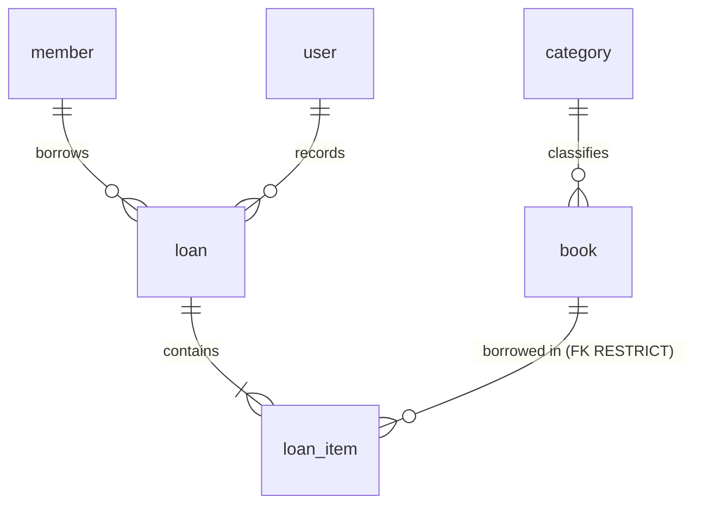

# Data Model — Manager Library

**The only place where the data model lives.** An implementer does not need to open the code or
connect to the engine to know what exists, its type, and its governing rule.

- Reference engine: PostgreSQL 16. Schema: `library`. Server in UTC.
- Governed by [`constitution.md`](constitution.md) and [`spec.md`](spec.md). If anything
  contradicts this document, this document prevails.

Every rule has one of **three labels**: **engine** (enforced by the database), **domain only**
(enforced only by code), or **pending (T-xx)** (implemented by that task in
[`tasks.md`](tasks.md)).

---

## 0. Naming convention

| Element | Convention | Example |
|---|---|---|
| Table | English, singular `snake_case` | `loan_item` |
| Column | English, singular, ASCII `snake_case` | `due_at` |
| Handwritten constraint | `ck_{table}_{rule}` | `ck_book_available_range` |
| Schema | `library` | `library.loan` |

In handwritten SQL, `user` is written as `library."user"`; the ORM quotes it automatically.

## 1. Glossary

| Term | Definition | Location |
|---|---|---|
| **Book** | Catalog title with author, ISBN, category, copies, and optional cover | `book` |
| **Category** | One of five fixed, seeded classifications with no maintenance operations | `category` |
| **Copy** | Physical copy of a book. It is counted, not individually identified | `book.total_copies`, `book.available_copies` |
| **Member** | Person who borrows books. Does not log in | `member` |
| **Loan** | Completed fact: who borrowed, who recorded it, and when | `loan` |
| **Loan item** | One book within a loan, including its due date and return | `loan_item` |
| **Loan status** | `open`, `overdue`, or `closed`. **Calculated, not stored** | no column |
| **User** | Internal operator with the `admin` or `librarian` role | `user` |
| **Frozen** | Copy of a value at loan time; it does not follow the catalog | `loan_item.book_title`, `isbn`, `category_name` |

## 2. Entities and relationships



Six entities, six tables. There is no report, fine, or audit table.

## 3. Physical model

No column has a `DEFAULT`: the domain supplies all values.

**`category`** — read-only seed data.

| Column | Type | Nullable | Note |
|---|---|---|---|
| `id` | `uuid` | no | PK. Literal identifiers (see §9) |
| `name` | `varchar(120)` | no | Unique |

**`book`**

| Column | Type | Nullable | Note |
|---|---|---|---|
| `id` | `uuid` | no | PK |
| `title` | `varchar(250)` | no | Trimmed by the domain |
| `author` | `varchar(200)` | no | |
| `isbn` | `char(13)` | no | Digits only. Unique among active books (partial index) |
| `category_id` | `uuid` | no | Restrictive FK to `category` |
| `total_copies` | `integer` | no | ≥ 1 |
| `available_copies` | `integer` | no | Between 0 and `total_copies` |
| `cover_key` | `varchar(512)` | **yes** | Opaque key; never a path or bytes; never an empty string |
| `deleted_at` | `timestamptz` | yes | Logical deletion. Null means active |

**`member`**

| Column | Type | Nullable | Note |
|---|---|---|---|
| `id` | `uuid` | no | PK |
| `full_name` | `varchar(200)` | no | |
| `document_number` | `varchar(30)` | no | Unique |

**`loan`**

| Column | Type | Nullable | Note |
|---|---|---|---|
| `id` | `uuid` | no | PK |
| `member_id` | `uuid` | no | Restrictive FK to `member` |
| `loaned_by_user_id` | `uuid` | no | Restrictive FK to `user` |
| `loaned_at` | `timestamptz` | no | Loan instant |

**`loan_item`**

| Column | Type | Nullable | Note |
|---|---|---|---|
| `id` | `uuid` | no | PK |
| `loan_id` | `uuid` | no | FK with `ON DELETE CASCADE` |
| `book_id` | `uuid` | no | Restrictive FK to `book` |
| `book_title` | `varchar(250)` | no | Frozen; same width as `book.title` |
| `isbn` | `char(13)` | no | Frozen |
| `category_name` | `varchar(120)` | no | Frozen; intentionally **no FK** |
| `due_at` | `timestamptz` | no | `loaned_at` + 14 days, calculated by the domain |
| `returned_at` | `timestamptz` | **yes** | Null until returned |

**`user`**

| Column | Type | Nullable | Note |
|---|---|---|---|
| `id` | `uuid` | no | PK |
| `username` | `varchar(120)` | no | Unique, lowercase, trimmed |
| `password_hash` | `varchar(512)` | no | Never indexed |
| `role` | `varchar(40)` | no | `admin` or `librarian` |

Cross-cutting rules: **all timestamps are `timestamptz`**; there are **no audit columns**
(`created_at`/`updated_at`) because no requirement asks for them.

## 4. Constraints and indexes: where each rule lives

| Rule | Object | Label |
|---|---|---|
| Primary keys for all six tables | `PK_*` | **engine** |
| Unique `category.name` | unique index | **engine** |
| Unique `member.document_number` | unique index | **engine** |
| Unique `user.username` | unique index | **engine** |
| ISBN unique among active books | partial unique index `WHERE deleted_at IS NULL` | **engine** |
| `book.category_id` → `category.id` RESTRICT | FK | **engine** |
| `loan.member_id` → `member.id` RESTRICT | FK | **engine** |
| `loan.loaned_by_user_id` → `user.id` RESTRICT | FK | **engine** |
| `loan_item.loan_id` → `loan.id` CASCADE | FK | **engine** |
| `loan_item.book_id` → `book.id` RESTRICT | FK | **engine** |
| `0 <= available_copies <= total_copies` | `ck_book_available_range` | **engine** — final concurrency barrier |
| `total_copies >= 1` | `ck_book_total_positive` | **pending (T-18)** · currently domain only |
| Unique `(loan_id, book_id)` | unique index | **engine** |
| `role` in (`admin`, `librarian`) | `ck_user_role` | **pending (T-18)** · currently domain only |
| Maximum three unreturned books per member | — | **domain only** (not expressible in a `CHECK`) |
| Member with overdue items cannot borrow | — | **domain only** |
| Decrementing a copy and creating an item are one operation | — | **domain only** (one transaction) |
| A loan has 1 to 3 items | — | **domain only** |
| Loans and returns are immutable except for `returned_at` | — | **domain only** (by absence of an operation) |

Access indexes: `book (category_id, title)` partial on active books; `loan (loaned_at)`;
`loan_item (book_id)`; `loan_item (due_at) WHERE returned_at IS NULL` for overdue items.

## 5. Foreign-key policy

| # | FK | `ON DELETE` | Rationale |
|---|---|---|---|
| FK-1 | `book.category_id` | RESTRICT | A category with books is not deleted |
| FK-2 | `loan_item.loan_id` | CASCADE | Composition: an item does not exist without its loan (never triggered because loans are not deleted) |
| FK-3 | `loan_item.book_id` | RESTRICT | Last-resort barrier: a manual deletion cannot orphan history |
| FK-4 | `loan.member_id` | RESTRICT | A loan's member does not disappear |
| FK-5 | `loan.loaned_by_user_id` | RESTRICT | Authorship is an accounting record |

`ON UPDATE NO ACTION` on every FK: application-generated UUID keys never change.

## 6. Access patterns

| # | Pattern | Frequency |
|---|---|---|
| Q1 | Search books (text, category, active, title order, paginated) | High |
| Q2 | Book by ID | High |
| Q3 | Books by a batch of IDs (before lending) | High, contention point |
| Q4 | List categories | High |
| Q5 | Loan with its items | Medium |
| Q6 | Loans by range, status, and member | High |
| Q7 | A member's unreturned items (count and overdue items) | High, for every loan |
| Q8 | All overdue items | Medium |
| Q9 | Report: most borrowed by range | High, most expensive |
| Q10 | User by username | High, for every login |

## 7. Privacy and retention

| Table | Attribute | Classification | Handling |
|---|---|---|---|
| `user` | `username` | Personal data | Restricted access |
| `user` | `password_hash` | **Secret** | Never in logs or responses; never indexed |
| `member` | `full_name`, `document_number` | **Personal data** | Only `admin` and `librarian`; **never** in the report or public endpoints |
| `loan`, `loan_item` | all | Commercial; `member_id` is indirect personal data | Indefinite retention |
| `book`, `category` | all | Public | Logical deletion / no deletion |

The report aggregates by book: it **does not expose members or librarians**.

**Retention:** loans and items are never deleted; books use logical deletion; the cover binary is the
**only** data physically deleted. Required order: first clear `cover_key` and commit the
transaction; then delete the binary.

## 8. Audit

The system does **not** include `created_at`/`updated_at`. Business instants already have columns:
`loan.loaned_at`, `loan_item.returned_at`, and `book.deleted_at`. If a question such as “who
changed this title?” arises, the decision returns to the product owner.

## 9. Seed strategy

The **five categories** are included in the initial migration with fixed identifiers:

| `id` | `name` |
|---|---|
| `11111111-1111-4111-8111-111111111111` | Novela |
| `22222222-2222-4222-8222-222222222222` | Ciencia |
| `33333333-3333-4333-8333-333333333333` | Tecnología |
| `44444444-4444-4444-8444-444444444444` | Historia |
| `55555555-5555-4555-8555-555555555555` | Infantil |

The database does **not** seed the initial administrator: application startup creates it from
environment credentials because only the hashing port can produce the hash. The demonstration data
seeder (`tool`) uses the **API**, never direct SQL.

## 10. How to prove this document is accurate

```sql
-- Must return the §3 columns, without any DEFAULT
SELECT table_name, ordinal_position, column_name, data_type, is_nullable, column_default
FROM information_schema.columns WHERE table_schema = 'library' ORDER BY 1, 2;

-- Constraints: PK, FK, and CHECK
SELECT c.conrelid::regclass, c.conname, c.contype, pg_get_constraintdef(c.oid)
FROM pg_constraint c JOIN pg_namespace n ON n.oid = c.connamespace
WHERE n.nspname = 'library' ORDER BY 1, 3, 2;

-- Indexes
SELECT tablename, indexname, indexdef FROM pg_indexes WHERE schemaname = 'library' ORDER BY 1, 2;
```

If a rule labeled **engine** does not appear, someone removed it. If a rule labeled **domain only**
appears, it has been moved down and must be reclassified. The database engine wins: the document is
wrong and must be corrected.
